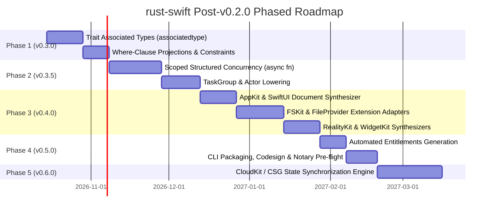

# Apple Ecosystem Integration: Certificates, Capabilities, Entitlements, and Framework Kits

**Architectural Specification & System Framework Integration Guide**  
*Lead Architect: [Zach Shallbetter](https://github.com/zachshallbetter) · [Reflective Rust Ecosystem](https://github.com/zachshallbetter/reflective-rust)*

---

## 1. Executive Doctrine: The Zero-FFI Advantage in the Apple Security Model

In conventional multi-language engineering on Apple platforms, integrating Rust via dynamic or static libraries (`.dylib`, `.a`, `.xcframework` through `UniFFI` or C-FFI) imposes a severe **"Binary FFI Tax"** across Apple's security, signing, and capability subsystems:

1. **The Code Signing Tax**: Every nested binary slice and foreign `.dylib` bundled into `Frameworks/` must be independently signed with secure timestamps, architecture-sliced via `lipo` to avoid App Store pre-check rejection, and sanitized against dynamic loader symbol collisions.
2. **The Hardened Runtime Tax**: Foreign runtimes frequently request JIT privileges (`com.apple.security.cs.allow-jit`) or executable memory trampolines (`com.apple.security.cs.allow-unsigned-executable-memory`), degrading host application posture.
3. **The Watchdog & Memory Ceiling Tax**: System extensions (FileProvider, FSKit, WidgetKit) operate under strict memory watchdog ceilings (often 30–50 MB). Heavy foreign runtimes (like Tokio event loops or generic allocators) trigger instantaneous jetsam/termination by `launchd`.

### The `rust-swift` Solution
`rust-swift` compiles Rust domain logic, finite state machines, mathematical engines, and algorithmic structures directly into **100% native Swift 5.9+ source packages**. 

Because the resulting code is pure Swift:
- **Single-Pass Native Compilation**: Emitted code compiles alongside the host app via `swiftc`. There are zero intermediate Mach-O libraries, zero foreign dylibs, and zero ad-hoc signature invalidations.
- **Strict Sandbox Conformance**: No unmanaged POSIX child processes, no prohibited system calls (`fork`, `exec`), and full compliance with Apple's strict `W^X` memory model.
- **Zero-Copy Kit Interoperability**: Rust data structures lower into Swift value types (`struct`) conforming directly to Apple system framework delegate protocols.

---

## 2. Apple Signing Identities & Certificate Topology

The compiler output supports all Apple code-signing identities without custom tooling:

```text
Apple Developer Program Identity Hierarchy
 ├── Apple Development / Mac Development
 │    └── Local debugging, LLDB symbolic stepping, SIP bypass for local profiling (get-task-allow)
 ├── Developer ID Application
 │    └── Direct macOS distribution outside the Mac App Store; Hardened Runtime + Apple Notary Service
 ├── Apple Distribution / Mac App Distribution
 │    └── App Store & TestFlight submission; strict App Sandbox enclosure (com.apple.security.app-sandbox)
 └── Developer ID Installer
      └── Flat macOS installer packages (.pkg) signed via productsign
```

### Direct Distribution & Automated Notarization
For macOS apps distributed outside the Mac App Store, `rust-swift` provides a production-grade packaging and notarization pipeline in [`scripts/apple-notarize.sh`](../scripts/apple-notarize.sh) and JWT token generator in [`scripts/asc-token.py`](../scripts/asc-token.py):

```bash
# Automated codesign, hardened runtime packaging, Apple notarytool submission, and ticket stapling
./scripts/apple-notarize.sh \
    --app build/Release/MyDesktopApp.app \
    --identity "Developer ID Application: Company LLC (TEAMID)" \
    --key-path ~/.private_keys/AuthKey_KEYID.p8 \
    --key-id KEYID \
    --issuer-id ISSUER_UUID
```

---

## 3. Capabilities & Security Entitlements Matrix

Applications incorporating `rust-swift` packages configure standard Apple property list entitlements (`.entitlements`). The emitted code complies with the following capability matrix:

| Entitlement Key | Category | Architectural Role | `rust-swift` Invariant |
|---|---|---|---|
| `com.apple.security.app-sandbox` | Sandbox | Restricts file, hardware, and network access | **Enforced**: Emitted Swift code executes within sandbox enclosure. |
| `com.apple.security.cs.allow-jit` | Hardened Runtime | Allows dynamic memory compilation | **Disabled (`false`)**: Pure AOT Swift compilation requires zero JIT. |
| `com.apple.security.cs.allow-unsigned-executable-memory` | Hardened Runtime | Allows execution of unsigned memory | **Disabled (`false`)**: Strict `W^X` adherence; no runtime code generation. |
| `com.apple.security.cs.disable-library-validation` | Hardened Runtime | Permits loading arbitrary third-party dylibs | **Disabled (`false`)**: Library validation remains intact (Zero FFI). |
| `com.apple.security.network.client` | Sandbox | Outgoing socket & HTTP connections | **Admitted**: Supported via Swift `URLSession` and network abstractions. |
| `com.apple.security.files.user-selected.read-write` | Storage | User file access via standard Powerbox | **Supported**: Conforms to `FileDocument` security-scoped bookmarks. |
| `com.apple.developer.fskit` | System Extension | User-space file system host entitlement | **Supported**: Native Swift classes implement `FSVolumeOperations`. |
| `com.apple.developer.fileprovider.testing-mode` | Storage | Cloud file syncing extension | **Supported**: Lightweight memory profile fits inside 30MB watchdog. |
| `com.apple.security.application-groups` | IPC / Data | Shared container across App and Extensions | **Supported**: `Codable` structs serialize cleanly into shared App Group containers. |
| `com.apple.developer.icloud-container-identifiers` | CloudKit | CloudKit database synchronization | **Supported**: Protocol-backed models project directly into `CKRecord`. |

---

## 4. The Apple "Kit" Ecosystem: Framework Integration Patterns

### A. AppKit (`macOS`)
- **Document Model**: Desktop document editors built in Rust (e.g., node graphs, vector art, audio sequences) translate into native Swift value types conforming to `FileDocument` or `ReferenceFileDocument`.
- **System Menu & Undo**: State transitions synthesize into native `UndoManager` registrations (`registerUndo(withTarget:)`).
- **Drag & Drop**: Inherent `Codable` synthesis provides turnkey conformance to `NSPasteboardWriting` and `NSPasteboardReading` through `UniformTypeIdentifiers`.

### B. FSKit (`macOS 15+ Sequoia`)
- **Modern File Systems**: FSKit replaces legacy kernel extensions (KEXTs) and macFUSE with high-assurance, user-space file systems (`FSFileSystem`, `FSVolume`).
- **The Rust-FSKit Pattern**: Complex file system logic—such as B-tree directory indexes, allocation bitmaps, journal transactions, and block-level cryptographic state machines—is authored in safe Rust.
- **Native Protocol Lowering**: `rust-swift` lowers these types into Swift classes conforming to:
  ```swift
  import FSKit

  public final class VirtualVolume: FSVolume, FSVolumeOperations {
      private var coreEngine: RustFileSystemEngine

      public func readItem(at path: String) throws -> Data {
          return self.coreEngine.readBlock(path: path)
      }
  }
  ```
  Because translation is zero-FFI, block transfers occur in-process without C-ABI marshaling or crossing kernel context boundaries.

### C. FileProvider & FileProviderUI (`iOS`, `macOS`)
- **Cloud Storage Engines**: FileProvider extensions power cloud syncing (similar to Box, OneDrive, Dropbox).
- **The Watchdog Invariant**: FileProvider extensions are killed if memory usage spikes above ~30–50 MB or startup takes >200ms.
- **Advantage**: `rust-swift` eliminates foreign runtime initialization and allocator fragmentation, ensuring synchronization state machines stay well within watchdog limits.

### D. RealityKit & ARKit (`visionOS`, `iOS`)
- **Spatial Entity-Component-System (ECS)**: In RealityKit, spatial entities attach components conforming to `RealityKit.Component` and `Codable`.
- **Turnkey RealityKit Synthesis**:
  ```rust
  #[derive(Clone, Debug, PartialEq, Codable)]
  pub struct PhysicsStateComponent {
      pub velocity_x: f64,
      pub velocity_y: f64,
      pub velocity_z: f64,
      pub restitution: f64,
  }
  ```
  lowers to:
  ```swift
  import RealityKit

  public struct PhysicsStateComponent: Component, Codable {
      public var velocity_x: Double
      public var velocity_y: Double
      public var velocity_z: Double
      public var restitution: Double
  }
  ```
  Components bind directly to `RealityView` attachments and volumetric window groups on visionOS.

### E. WidgetKit (`iOS`, `macOS`, `watchOS`)
- **Timeline Evaluation**: WidgetKit extensions execute transiently to calculate an array of `TimelineEntry` snapshots and immediately hibernate.
- **Zero Cold-Start Overhead**: Rust algorithmic schedulers compile into Swift structs conforming to `TimelineProvider`, generating timeline entries in microseconds with zero cold-start delay.

### F. ScreenCaptureKit (`macOS 12.3+`) & CoreMedia
- **Low-Latency Streaming**: Rust state machines manage capture stream states (`SCStreamConfiguration`), filtering display/window surfaces, and processing high-throughput frame metadata.

### G. MetricKit & StoreKit 2
- **StoreKit 2**: Admitted Rust subscription models bind cleanly to modern Swift async StoreKit 2 APIs (`Product.SubscriptionInfo`, `Transaction.currentEntitlements`).
- **MetricKit**: Crash, hang, and energy telemetry reports (`MXMetricPayload`) map back to compiler source locations via `#sourceLocation` directives.

---

## 5. Phased Horizon Architecture



### Track Details:
1. **Phase 1: Trait Associated Types (`v0.3.0`)**: Support `type Item;` in traits across `rust-swift-frontend`, `rust-swift-ir`, and `rust-swift-codegen`.
2. **Phase 2: Structured Concurrency (`v0.3.5`)**: Replace diagnostic rejection `E0002` with an admitted async grammar that lowers Rust futures directly to Swift `async/await` and `TaskGroup`.
3. **Phase 3: Apple Kit Protocol Adapters (`v0.4.0`)**: Attribute-driven macro synthesis for `FileDocument`, `FSVolumeOperations`, and `RealityKit.Component`.
4. **Phase 4: Packaging & Security Verification (`v0.5.0`)**: Add `rust-swift verify-packaging` CLI command to validate code signatures, hardened runtime flags, and entitlement plists before App Store or Developer ID deployment.
5. **Phase 5: CloudKit & Distributed CSG Synchronization (`v0.6.0`)**: Project Reflective Rust Compiler Semantic Graphs into CloudKit private/shared databases for multi-device peer state replication.
